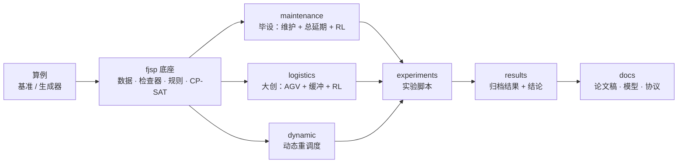

# fjsp-lab：车间调度研究平台

> A test-covered research platform for shop scheduling: flexible job shop (FJSP), dynamic rescheduling,
> parallel machines with maintenance windows (graduation thesis), and FJSP with AGV transport and finite buffers
> (innovation project). Every schedule is accepted only after an independent feasibility checker.

## 这是什么

工厂要决定"哪个工件在哪台机器上、什么时候加工"，这就是**调度**。本仓库是一个用 Python 写的调度研究平台，承载两个课题：

- **毕业设计**：多台相同机器加工一批工件，每台机器还要在规定时间窗内停机维护。研究如何同时安排生产和维护，使工件**总延期**最小，
  主方法是**注意力网络强化学习**，并与派工规则、遗传算法/模拟退火、精确求解器比较。
- **大创项目**：工件在机器之间由 **AGV 小车**搬运，机器前的**缓冲区**容量有限、可能**死锁**。研究如何联合安排加工与搬运，
  使全部工件最早完工，方法包括事件仿真 + 死锁规避、强化学习打分策略、模拟退火、精确求解器。

两者共用一个经过充分测试的底座：标准柔性作业车间（FJSP）的数据结构、统一的调度结果和**独立的合法性检查器**。



完整的结构图、各部分作用与关系见 **[项目全景](docs/overview.md)**。

## 从哪里开始读

| 你想… | 读这个 |
|---|---|
| 理解整个项目在做什么、各部分怎么连 | [docs/overview.md](docs/overview.md)（全景与流程图） |
| 理解模型和算法的原理 | [docs/methods.md](docs/methods.md) |
| 查一个不懂的术语 | [docs/glossary.md](docs/glossary.md) |
| 知道现在做到哪、结论是什么、下一步做什么 | [START_HERE.md](START_HERE.md) |
| 看某个实验的数据和结论 | [experiments/README.md](experiments/README.md) → `experiments/results/<名称>/findings.md` |
| 写毕设论文 | [论文大纲](docs/plans/thesis_outline.md)、[第 2 章草稿](docs/models/thesis_ch2_model_zh.pdf)、[文献地图](docs/literature/graduation_literature_map.md) |
| 改大创论文 | [大创论文初稿](docs/manuscripts/innovation_paper_zh.pdf)、[物流模型](docs/models/logistics_model_zh.md) |
| 改代码 | [AGENTS.md](AGENTS.md)（开发规则），然后看 `src/fjsp_lab/` 对应子包开头的说明 |

## 目录

```text
src/fjsp_lab/        库代码
  fjsp/              静态柔性作业车间底座（Phase 1）
  dynamic/           动态事件与重调度（Phase 2A）
  maintenance/       毕设：平行机 + 维护窗口 + 总延期；规则、GA/SA/IGA、CP-SAT、注意力强化学习
  logistics/         大创：FJSP + AGV + 缓冲 + 阻塞；仿真器、死锁规避、规则、SA/GA、CP-SAT、强化学习
tests/               自动测试（按子包分目录）
experiments/         实验脚本；results/ 当前归档结果；archive/ 重构前的归档结果；inputs/ 协议输入
instances/           30 个 FJSPLib 基准算例与已知最好值；external/ 第三方数据（仅本地，不入库）
docs/                overview / methods / glossary（导读）；models/ 数学模型；protocols/ 实验协议；
                     plans/ 论文大纲与大创设计；literature/ 文献；manuscripts/ 论文稿
scripts/             setup_env.ps1 建环境；run_checks.ps1 一键检查
```

## 快速开始

```powershell
powershell -ExecutionPolicy Bypass -File .\scripts\setup_env.ps1   # 在项目内建专用 Conda 环境 .conda-env
powershell -ExecutionPolicy Bypass -File .\scripts\run_checks.ps1  # 运行全部测试 + Phase 1/2A 实验
```

不安装也能用：测试通过 `pyproject.toml` 的 `pythonpath = ["src"]` 找到代码，实验脚本由 `experiments/_common.py` 把 `src/` 加入路径。

```python
# 静态 FJSP：用 EFT 规则排一个玩具算例，并用检查器核对
from fjsp_lab.fjsp import create_toy_instance, solve_rule, check_feasibility
result = solve_rule(create_toy_instance(), "EFT")
assert check_feasibility(result)[0]

# 毕设模型：生成一个 24 工件、4 台机器的算例，用改进遗传算法（联合维护）求解
from fjsp_lab.maintenance.generator import build_instance
from fjsp_lab.maintenance.metaheuristics import solve_metaheuristic
data = build_instance(24, 4, alpha=30, beta=75, tau=75, seed=101)
plan = solve_metaheuristic(data, mode="joint", algorithm="IGA", evaluations=10000).result
print(plan.total_tardiness)
```

注意力策略（`maintenance.attention_policy`、实验 `g6`、`g8`）需要 PyTorch，其余代码不需要。

## 正确性约定

- **先检查再返回**：每个算法在返回调度前都调用对应的检查器；不合法就抛异常，绝不把非法调度当作结果。
- **检查器独立**：检查器不复用算法的计算，而是逐条核对约束并重新计算目标值。
  - 静态检查：每道工序恰好一次、工艺顺序、机器不重叠、可选机器、时长正确、makespan 一致；
  - 维护模型另查：每个窗口恰好一次维护、完整落在窗口内、不与加工重叠、总延期重算一致；
  - 物流模型另查：每段运输恰好一次且路线正确、车辆行程连贯、取货不早于完工、送达不晚于开工、阻塞与工位容量。
- **数据不可变**：算例创建后不能修改；时间与编号必须是整数。
- **最优要有证明**：CP-SAT 返回 `OPTIMAL` 才说最优，`FEASIBLE` 只是限时可行解。
- **结果可追溯**：每个结果目录的 `manifest.json` 记录 git 提交和全部源码的哈希；正式结果要求运行时没有未提交的改动。
