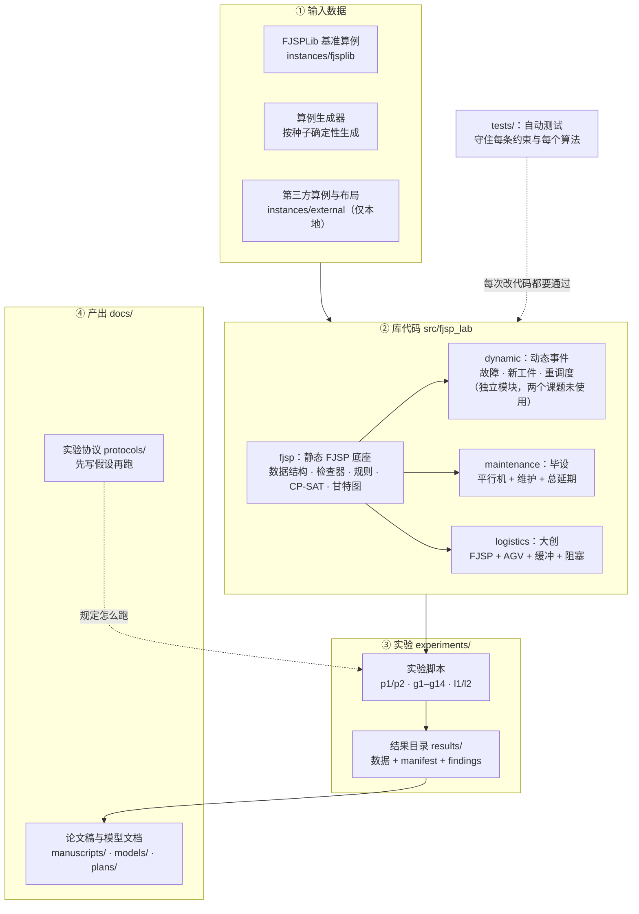
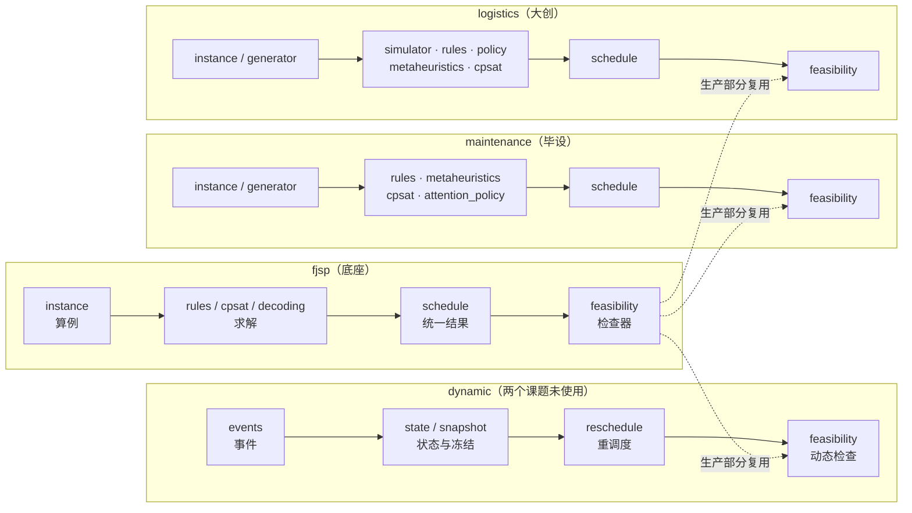
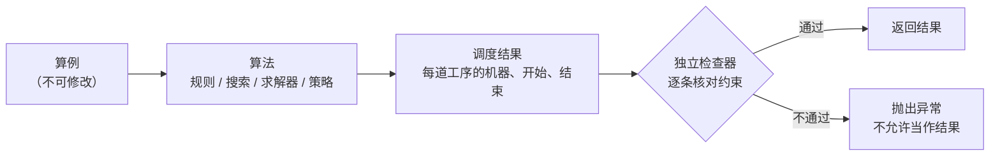
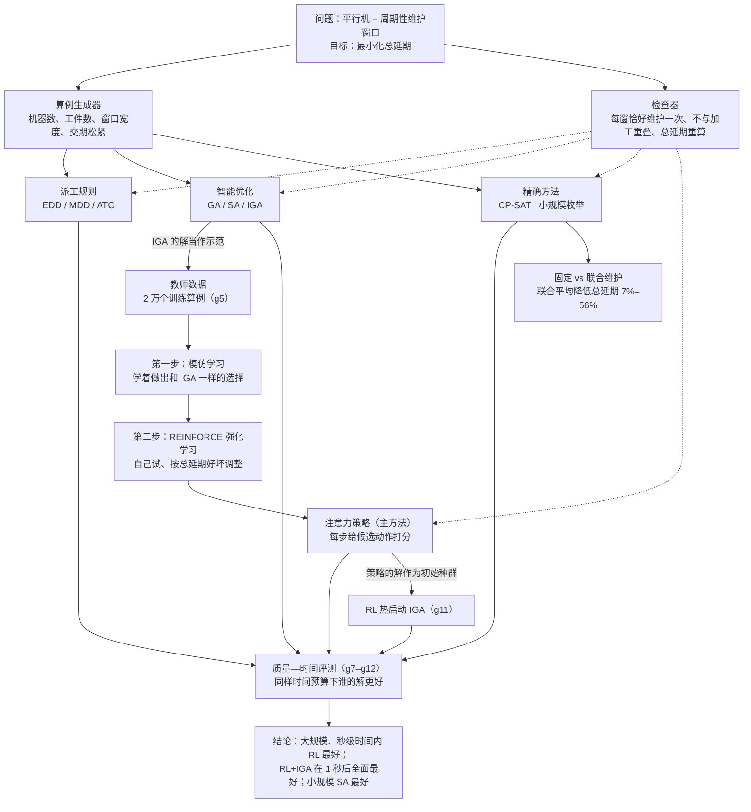
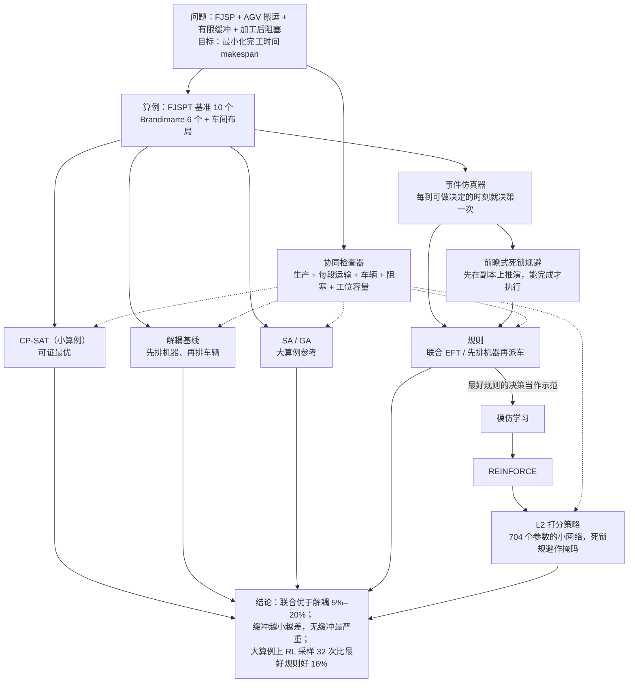
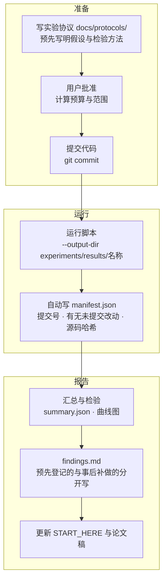
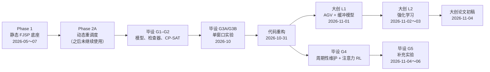

# 项目全景：这个项目在做什么、由哪些部分组成、它们怎么连在一起

> 第一次接触本项目，先读这一页。读完应能回答：研究什么问题、代码分几块、每块干什么、实验结果从哪里来。
> 术语不懂查 [术语表](glossary.md)，算法原理看 [模型与算法原理](methods.md)。
> 图用 Mermaid 绘制：GitHub 与带 Mermaid 插件的 VS Code 能直接显示；也可用浏览器打开 [project_map.html](project_map.html) 查看。

## 1. 一段话说清楚

工厂里要决定"哪个工件在哪台机器上、什么时候加工"，这叫**调度**。本项目是一个调度研究平台，里面有两个研究课题：

| 课题 | 研究的问题 | 主要方法 | 状态 |
|---|---|---|---|
| **毕业设计（毕设）** | 多台相同的机器要加工一批工件，每台机器还必须在规定的时间窗内停机**维护**。怎样安排加工和维护，才能让工件**总延期**（超过交期的时间之和）最小？维护时间是事先定死好，还是和生产一起优化好？ | 注意力网络强化学习（主方法），与派工规则、遗传算法/模拟退火、精确求解器对比 | 实验完成，待写正文 |
| **大学生创新项目（大创）** | 车间里工件在机器之间要靠 **AGV 小车**搬运，机器前的**缓冲区**又有容量限制，可能堵死（**死锁**）。怎样同时安排加工和搬运，让全部工件最早完工？ | 事件仿真 + 前瞻式死锁规避、强化学习打分策略，与规则、模拟退火、精确求解器对比 | 实验与论文初稿完成 |

两个课题都建立在同一个**底座**上：标准的柔性作业车间调度（FJSP）数据结构、调度结果格式和**合法性检查器**。
底座里还有一个**动态重调度**模块（Phase 2A：机器故障、新工件到达时重排剩余工序），它是早期搭好的独立功能，
**目前毕设和大创都没有用到**：两个课题研究的都是静态、确定性问题（见第 3 节说明）。
平台的核心约定是：**任何算法给出的调度，都必须先通过独立的检查器，否则直接报错，不当作结果。**

## 2. 总体结构图

**读图方法**：数据（①）交给库代码（②）里的模型和算法；实验脚本（③）按协议调用这些算法，把结果连同"用的是哪一版代码"一起存档；
存档的结论再写进论文（④）。测试保证库代码一直正确。

## 3. 库代码的四个子包

依赖只朝一个方向：其他三个子包都用 `fjsp` 的数据结构和检查器，彼此之间互不依赖。

| 子包 | 一句话 | 主要文件 |
|---|---|---|
| `fjsp` | 标准柔性作业车间：读算例、7 条派工规则、CP-SAT 精确模型、检查器、甘特图 | `instance.py` `rules.py` `cpsat.py` `feasibility.py` |
| `dynamic` | 加工途中发生机器故障、新工件到达、加工时间变化时，保留已做的部分，重排剩下的。**目前只由 `p2` 实验和测试使用，毕设、大创都未使用** | `events.py` `reschedule.py` `feasibility.py` |
| `maintenance` | 毕设模型及其全部算法：规则、GA/SA/IGA、CP-SAT、枚举、构造环境、注意力策略 | `metaheuristics.py` `sequence_env.py` `attention_policy.py` |
| `logistics` | 大创模型：AGV 搬运与缓冲的事件仿真器、死锁规避、规则、SA/GA、CP-SAT、强化学习策略 | `simulator.py` `rules.py` `policy.py` |

**关于 `dynamic` 的现状**：

- 毕设的任务是静态问题（工件 0 时刻全部到达、维护窗口事先已知），动态重调度只在论文展望里提到；
- 大创 L1/L2 也是静态问题。大创申请书要求纳入"动态扰动"，这部分**尚未开展**，需要用户单独批准；
- 将来做大创的动态阶段时，`dynamic` 不能直接套用：它只描述普通 FJSP，没有工件位置、车辆和缓冲。
  更自然的做法是在大创的事件仿真器（`logistics.simulator`）里加入"新工件到达""机器故障"等事件，
  L2 策略本身就在每个事件点做决策，可以直接在线应对；
- Phase 2A 能复用的是思路：事件格式、冻结已执行部分、动态检查器要核对的内容（到达时刻、不可用时段）。

每个子包都遵循同一条流水线：**算例 → 算法 → 统一的调度结果 → 检查器 → 通过才返回**。

## 4. 毕设：从问题到结论

实验分批推进，每一批回答一个问题：

| 批次 | 回答的问题 | 结果位置 |
|---|---|---|
| G1、G2 | 模型和检查器对不对？CP-SAT 与暴力枚举是否给出相同最优值？ | 测试 `tests/maintenance/` |
| G3A | 单维护窗口时，联合优化维护比固定维护好多少？（n = 8 时可证最优） | `experiments/archive/exp_035_*` |
| G3B、R1/R2 | 早期的打分策略和规则、元启发式比怎样？ | `experiments/archive/exp_036`–`041` |
| G4 | 周期性多窗口、n 到 100 时，RL 和搜索算法在不同时间预算下谁更好？ | `experiments/results/g4_summary/` |
| G5 | 结论在新测试集上还成立吗？换训练种子呢？强化学习这一步有用吗？RL 热启动 IGA、n = 200 推广？ | `experiments/results/g5_summary/` |

## 5. 大创：从问题到结论

| 批次 | 回答的问题 | 结果位置 |
|---|---|---|
| L1 基准 | 模型是否和公开基准一致？阻塞和缓冲大小有多大影响？ | `results/l1_benchmark/` |
| L1 解耦 | "先排机器再派车"比联合优化差多少？ | `results/l1_decoupled/` |
| L1 大算例 | 大算例上规则会不会死锁？前瞻式规避是否总能给出合法调度？ | `results/l1_large/` |
| L1 搜索 | SA/GA 能比规则好多少？距最优多远？ | `results/l1_search/` |
| L2 | 强化学习策略能否超过规则和 SA？ | `results/l2_formal_train/`、`results/l2_formal_test/` |

## 6. 一次正式实验是怎么做出来的

这样做的目的：任何一个数字都能追溯到"用哪一版代码、在什么输入上跑出来"，别人可以重跑核对。
已归档的结果目录不再修改；有新想法就跑到新目录里。

## 7. 项目时间线

## 8. 目录逐个说明

| 路径 | 作用 | 什么时候看 |
|---|---|---|
| `README.md` | 项目入口：简介、怎么运行、去哪看什么 | 第一次打开 |
| `START_HERE.md` | 当前进度、关键结论、下一步 | 想知道"做到哪了" |
| `AGENTS.md` | 开发规则（环境、证据、禁止事项），也给 AI 助手读 | 改代码之前 |
| `docs/overview.md` | 本页：全景与流程图 | 想理解整体 |
| `docs/methods.md` | 模型与算法原理（通俗解释） | 想理解算法 |
| `docs/glossary.md` | 术语表 | 遇到不懂的词 |
| `docs/models/` | 正式数学模型（LaTeX/PDF）与模型说明 | 写论文第 2 章 |
| `docs/protocols/` | 各批实验的预先登记协议 | 想知道实验怎么设计的 |
| `docs/plans/` | 毕设论文大纲；大创建模决策与 RL 设计 | 写论文、做决策 |
| `docs/literature/` | 毕设文献地图、大创查新报告 | 写综述 |
| `docs/manuscripts/` | 大创论文初稿（LaTeX/PDF） | 改论文 |
| `src/fjsp_lab/` | 全部库代码 | 想看实现 |
| `tests/` | 自动测试，按子包分目录 | 改代码后运行 |
| `experiments/*.py` | 实验脚本（编号见 [experiments/README](../experiments/README.md)） | 想重跑实验 |
| `experiments/results/` | 重构后代码的归档结果，每个目录绑定其 manifest 中的提交，多数有 findings | 想看数据与结论 |
| `experiments/archive/` | 2026-10-31 重构前的归档结果（只读证据） | 核对早期结论 |
| `experiments/inputs/` | Phase 2A 协议与事件文件 | 动态实验 |
| `instances/` | 30 个 FJSPLib 基准算例与已知最好值；`external/` 只在本地 | 静态实验、大创 |
| `scripts/` | 建环境、一键检查 | 配环境、提交前 |
